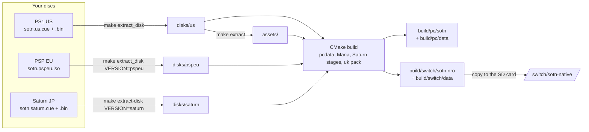

# sotn-native

A native port of Castlevania: Symphony of the Night for PC (Linux) and Nintendo Switch.
It is built from the [sotn-decomp](https://github.com/Xeeynamo/sotn-decomp) decompilation
and runs on [psyz](https://github.com/Xeeynamo/psyz), a PlayStation SDK for modern systems.
The port adds content from the Sega Saturn and PSP versions and a Ukrainian translation.

Українською: [README.uk.md](README.uk.md). The upstream README: [README.upstream.md](README.upstream.md).

**No game data is in this repository.** You need your own, legally obtained discs.
The build reads them from your disk and makes the game files on your machine.

## Quick start

1. Get the source. Clone it in Linux or in WSL 2 (see "Windows" below):

   ```sh
   git clone --recurse-submodules -b switch https://github.com/rashevskyv/sotn-native.git
   ```

2. Put your disc images into the folder `games/` of the clone. The file names do not matter.
   The build finds each disc by its content.
3. Start the build:
   - Windows: double-click `build.bat`. It runs the build in WSL and opens `out\` at the end.
   - Linux or WSL: `python3 build.py`.

| Image in `games/` | Files | Adds |
|---|---|---|
| PlayStation, USA (SLUS-00067) | `.bin` (and `.cue`) | The game. Required. |
| PSP, Castlevania: The Dracula X Chronicles, Europe (ULES-00841) | `.iso` or `.cso` | Maria as a player, her voice, the PSP familiar names. |
| Sega Saturn, Japan (T-9527G) | `.bin` (and `.cue`) | The Saturn stages, the character select art. |
| `ps1vram_uk.bin` of the Ukrainian Xbox 360 mod | The file | Ten Ukrainian labels: file select, name plate, HUD. Optional. |

The build makes two folders:

| Folder | What to do with it |
|---|---|
| `out/sd/` | Copy its contents to the root of the SD card. It holds `switch/sotn-native/` with `sotn.nro` and the game data. |
| `out/pc/` | The PC build. Start `out/pc/run.sh` (Linux) or `out\pc\run.bat` (Windows). |

More about the build:

- A missing tool stops the build. The build prints the command that installs it.
  `python3 build.py --install-deps` runs these commands with `sudo` (apt and devkitPro pacman).
- Options: `--pc-only`, `--switch-only`, `--clean` (start again from nothing).
- A second run skips the steps that are done.
- The log is `out/build.log`. On an error the build names the step that failed.
- The first build downloads Go modules, Rust crates and the devkitPro fork of SDL. It needs the network.
- The build makes the Ukrainian pack from this repository and the US disc.
  Ten labels also need `ps1vram_uk.bin` (see "Ukrainian language"). Without it they stay in English.
- `out/sd/` has no `sotn.ini`. The game writes it at the first start. A copied file would replace your settings.
- The game files in `out/` are hard links to the files in `build/auto/`. They use the disk space only once.

### Windows

`build.py` and `build.bat` make the Linux build. It runs in WSL 2, and WSLg shows its window.
A native Windows build (`sotn.exe`) also exists. It is a manual MinGW build, see "Build for Windows" below.
`build.bat` needs WSL 2 with Ubuntu. If it is missing, `build.bat` prints the install command (`wsl --install -d Ubuntu-24.04`).

Clone the repository inside WSL, for example in `\\wsl.localhost\Ubuntu-24.04\home\<user>\`.
A clone on a Windows drive (`C:\`, `D:\`) also works, but the build is much slower there.
If you clone with Git for Windows, switch off the line end change: `git clone -c core.autocrlf=false ...`.

## What works

| Part | State |
|---|---|
| PC (Linux, x86-64) build of the PS1 US game | Works. Main test platform for the code. |
| PC (Windows, x86-64) build, MinGW, one `sotn.exe` | Works. Manual build (see "Build for Windows"). |
| Nintendo Switch NRO (homebrew) | Works. Tested on one console. |
| 16:9 view at an integer scale, port menu, button icons, rumble on damage (Switch) | Works. |
| Saturn stages: Underground Garden, Cursed Prison and their inverted versions; stitched rooms | Experimental. Enemies and bosses are ported by hand and can differ from the Saturn game. |
| Saturn character select screen | Works. Needs the Saturn disc for its art. |
| Maria as a player (from the PSP version) | Experimental. |
| PSP familiar names, the two JP familiar cards | Works (the cards are an option). |
| Voice sets (Japanese and PSP English) | Works, but see "Voice sets" below: the pack cannot be made from this repository alone yet. |
| Ukrainian language | Works. Without `ps1vram_uk.bin` ten labels stay in English (see "Ukrainian language" below). |
| Cheats, teleport map, tile editor page (port 8080, no password) | Test tools. |

Offline tests: `python3 tools/test/run.py offline` (no game data needed).
Tests with the game and the release checks: see [docs/TESTING.md](docs/TESTING.md). Most game tests are still manual. Expect bugs.

More documents:

- [docs/ASSET_SOURCES.md](docs/ASSET_SOURCES.md): where each piece of game data comes from. Nothing proprietary is in git.
- [docs/FONTS.md](docs/FONTS.md): each font, where it is used, its licence.
- [docs/TESTING.md](docs/TESTING.md): the tests and the release checklist.

## What you need

### Discs

Put your own disc images in `disks/` (see below). sotn-decomp names each version.

| Disc | sotn-decomp name | Required | Adds |
|---|---|---|---|
| PlayStation, US (SLUS-00067) | `us` | Yes | The whole game. |
| PSP, Castlevania: The Dracula X Chronicles, Europe (ULES-00841) | `pspeu` | No | Maria as a player, her voice, familiar names. |
| Sega Saturn, Japan (T-9527G) | `saturn` | No | The Saturn stages, the character select art. |

The build checks only that the files it needs exist. Other releases of the discs are not tested.

### Tools (Debian or Ubuntu, also under WSL 2)

- The upstream packages: `sudo apt install $(cat tools/requirements-debian.txt)`.
- CMake 3.28 or later, Ninja, a C and C++ compiler (GCC or Clang).
- Rust (`rustup`, stable `cargo`). Every build needs it.
- Go 1.24 or later. Every build needs it (the disc and asset tools are in Go).
- `xxd` (Maria's voice), `7z` (PSP), `bchunk` (Saturn), `ffmpeg` with the ATRAC3plus decoder (voice sets).
- Python 3 with Pillow (with FreeType and libraqm), PyYAML and numpy:
  `sudo apt install python3-pil python3-yaml python3-numpy libraqm0`.
  Check: `python3 -c "from PIL import features; print(features.check('freetype2'), features.check('raqm'))"` prints `True True`.
- For the Linux build: the X11 or Wayland development packages that SDL3 needs
  (see the SDL3 documentation; SDL is built from `tools/psyz/external/SDL`).

For the Switch build you also need:

- [devkitPro](https://devkitpro.org/wiki/Getting_Started) with `switch-dev`, `switch-mesa` and `switch-libdrm_nouveau`
  (`sudo dkp-pacman -S switch-dev switch-mesa switch-libdrm_nouveau`).
- The devkitPro fork of SDL3, branch `switch-sdl-3.4`, with the patch from this repository:

  ```sh
  git clone -b switch-sdl-3.4 https://github.com/devkitPro/SDL.git ~/SDL-switch
  git -C ~/SDL-switch am "$PWD/tools/sdl-switch/0001-switch-SetWindowSize-uses-the-pending-size.patch"
  ```

  Run the second command from the root of this repository.

## How the parts fit



## Manual build

These are the steps that `build.py` does for you.

### 1. Get the source

```sh
git clone --recurse-submodules -b switch https://github.com/rashevskyv/sotn-native.git
cd sotn-native
```

### 2. Put the discs in `disks/`

- PS1: the `.cue` file and its `.bin` tracks. Rename the cue file to `disks/sotn.us.cue`.
  The `FILE` lines in the cue must point at the `.bin` files (relative to `disks/`).
- PSP: `disks/sotn.pspeu.iso`.
- Saturn: `disks/sotn.saturn.bin` and `disks/sotn.saturn.cue`.

### 3. Extract the discs

```sh
make extract_disk                       # PS1 -> disks/us
make extract_disk VERSION=pspeu         # PSP -> disks/pspeu (optional)
make extract-disk VERSION=saturn        # Saturn -> disks/saturn (optional)
make python-dependencies                # Python tools of sotn-decomp, in .venv
make extract                            # PS1 assets -> assets/
make build_assets                       # assets -> src/**/gen/ (C files, not in git)
```

The PSP step needs only these files from the image:
`PSP_GAME/USRDIR/res/ps/PSPBIN/dra.bin`, `maria.bin` and `res/ps/snd_e/SE/sd_mar2.spk`.

### 4. Build for PC (Linux)

```sh
cmake -S . -B build/pc -G Ninja -DENABLE_ASAN=OFF -DPSYZ_RENDERER=sdl3_gl \
      -DENABLE_SATURN_STAGES=ON
cmake --build build/pc
```

- Leave out `-DENABLE_SATURN_STAGES=ON` if you have no Saturn disc.
- Maria is switched on by itself when `disks/pspeu/.../maria.bin` exists (`-DUSE_PLAYER_MARIA=OFF` to switch her off).
- Optional: `-DSOTN_CHARSEL_ART=<folder>` with your own portraits for the character select screen
  (`alucard.webp`, `richter.webp`, `maria_psp.png`, `maria_psx.png`). A missing file uses the Saturn portrait.
- `make pc` is a short way to build with the default options.

Run it:

```sh
build/pc/sotn
```

The game reads its files from `build/pc/data` (a copy of `disks/us`, plus the Saturn stages).
The window is 1280x720 and the view is 16:9 at scale 3. `--wide N` sets another scale.
Settings: `build/pc/sotn --ini sotn.ini` reads and writes a settings file (see "Settings").

### 5. Build for Nintendo Switch

```sh
export DEVKITPRO=/opt/devkitpro
cmake -S . -B build/switch -G Ninja \
      -DCMAKE_TOOLCHAIN_FILE=$DEVKITPRO/cmake/Switch.cmake -DCMAKE_BUILD_TYPE=Release \
      -DENABLE_ASAN=OFF -DPSYZ_RENDERER=sdl3_gl -DPSYZ_SDL_DIR=$HOME/SDL-switch \
      -DENABLE_SATURN_STAGES=ON
cmake --build build/switch
```

The result is `build/switch/sotn.nro`. The same optional settings as for PC apply.

### Build for Windows

The Windows build is a cross build with MinGW-w64 (`sudo apt install mingw-w64`), in Linux or WSL:

```sh
cmake -S . -B build/win -G Ninja \
      -DCMAKE_TOOLCHAIN_FILE=tools/psyz/psyz/cmake/windows-x86_64.cmake -DCMAKE_BUILD_TYPE=Release \
      -DENABLE_ASAN=OFF -DPSYZ_RENDERER=sdl3_gl -DPSYZ_STATIC_MODULES=ON -DSOTN_PC_DATA_DIR=data \
      -DENABLE_SATURN_STAGES=ON
cmake --build build/win
```

The result is `build/win/sotn.exe`: one file, no DLLs, no console window.
Put it in a folder with the game files in `data/` (as `out/pc/`). The log is `sotn.log` next to it.

### 6. Install on the Switch

The port uses its own folder, `/switch/sotn-native/`, on the SD card:

| Path on the SD card | What | From |
|---|---|---|
| `/switch/sotn-native/sotn.nro` | The program | `build/switch/sotn.nro` |
| `/switch/sotn-native/data/` | The game files | `build/switch/data/` (all of it) |
| `/switch/sotn-native/data/ST/<STAGE>/F_<STAGE>.BIN` | Saturn stitched rooms (only with Saturn stages) | `build/switch/saturn_stitches/disks/us/ST/` (copy over `data/ST/`) |
| `/switch/sotn-native/voice/jp/`, `voice/psp/` | Voice sets (optional) | see "Voice sets" |
| `/switch/sotn-native/music/` | Music files (optional) | see "Music files" |
| `/switch/sotn-native/sotn.ini` | Settings | written by the game at the first start |

The game also writes these files there: `sotn-xa.cue` (music; it points at `data/SD/XA_STR1`),
`sotn.log`, `sotn.prev.log`, `sotn.out.log` and the memory cards `bu00/` and `bu10/`.
No other files are needed. Start the port from the homebrew menu.

## Settings (`sotn.ini`)

The game writes the file with the default values when it is missing.
The port menu changes most of them in the game. A missing key keeps its default.

| Key | Values | Default | Effect |
|---|---|---|---|
| `scale` | 1 to 8, `max` | 3 | Integer pixel scale of the 16:9 view. `max` always takes the highest scale that fits the screen. |
| `fullscreen` | 0, 1 | 0 | PC: start in borderless fullscreen. F11 (or F4) switches it in the game; Esc leaves it, a second Esc quits. |
| `voice` | `ps1`, `jp`, `psp` | `ps1` | Voice set. `jp` and `psp` need the clips in `voice/`; a missing clip plays the PS1 voice. |
| `language` | `en`, `uk` | `en` | Language. A change needs a restart. `uk` without the pack shows English. |
| `buttons` | `switch`, `xbox`, `psx` | `switch` on Switch, `xbox` on PC | The button icons in the menus. |
| `jp_cards` | `extra`, `jp`, `off` | `extra` | The two JP familiar cards: added next to the US items, in the JP/PSP places, or not at all. Read at start. |
| `relic_toggle` | `modern`, `stock` | `modern` | The picture of the relic switch. |
| `spawn` | a name, or empty | empty | Test start point: `np3-stage15-door`, `marble-soul`, `caverns-soul`, `reverse-trapdoor-underground`, `reverse-marble-soul`, `reverse-caverns-soul`. |
| `cheat_refill` | 0, 1 | 0 | HP, MP and hearts stay full. |
| `cheat_invincible` | 0, 1 | 0 | Hits do nothing. |
| `cheat_walls` | 0, 1 | 0 | Mist form passes every wall and does not end. |
| `cheat_items` | 0, 1 | 0 | All weapons, items and relics. |
| `cheat_map` | 0, 1 | 0 | The whole map of both castles. |
| `cheat_skip_prologue` | 0, 1 | 0 | A new game starts as Alucard at the castle gate. |
| `cheat_character` | 0, 1, 2, 4 | 0 | Who plays a loaded save: 0 the game's rule, 1 Alucard, 2 Richter, 4 Maria. |
| `editor` | 0, 1 | 0 | Tile editor page on port 8080. No password: use it only on a trusted network. |
| `overlay` | 0, 1 | 0 | A corner shows the stage, the room and the cheats. |
| `fps` | 0, 1 | 0 | A corner shows the frames per second. |
| `music_files` | 0, 1 | 1 | Play the music from `music/` when a file is there (see "Music files"). 0 always plays the disc music. |

The key `aspect` of old files is ignored: the view is always 16:9.
Saturn stages and Maria are build options, not settings. Rumble is always on (Switch).

## Voice sets

`tools/voicepack/extract_voice.py` makes `voice/jp/` and `voice/psp/` from the PSP image.
It needs two manifest files that map each sound to a clip in the image.
The manifests are not in this repository yet, so the voice sets cannot be made from it alone.
Without them the game uses the PS1 voices.
The plan for manifests in git (no audio, no text): [docs/ASSET_SOURCES.md](docs/ASSET_SOURCES.md).

## Music files

The game can play each music track from a file in `music/` next to the game.
The name is the track number in hex: `music/30F.mp3` or `music/30F.flac`.
The file must be 44100 Hz, mono or stereo. A FLAC file is used before an MP3 file.
Without a file the game plays the disc music (XA), as on the PS1.
The game's volume, fade, pause and loop commands work on both.

`music/loops.txt` is optional. Each line is `id start loop_start loop_end level`:
frames at 44100 Hz, and a gain in 1/256 (256 = no change). A loop end of 0 plays the track once.
Without a line, a looping track repeats the whole file.
`tools/music/ost_map.py copy <ost folder> <game>/music` names the tracks of the soundtrack album
and writes `loops.txt` for them. No audio is in this repository.

## Ukrainian language

The text, fonts and drawn labels are in `tools/lang/uk/` (see `tools/lang/FORMAT.md`).
The build makes the pack from these files and the US disc.
Ten labels keep pixels of the stock pictures: the five file select titles, the name plate and the HUD plates.
These ten labels are not in git. They come from `ps1vram_uk.bin` of the Ukrainian Xbox 360 mod.
Put that file into `games/`, and the build adds them. Without it these labels stay in English.
The mod files are not public yet.

## Credits

- [sotn-decomp](https://github.com/Xeeynamo/sotn-decomp): Luciano Ciccariello (Xeeynamo) and all its contributors. See [README.upstream.md](README.upstream.md) for the tools they thank.
- [psyz](https://github.com/Xeeynamo/psyz) by Xeeynamo (MIT), with SDL (libsdl.org) and cimgui.
- sotn-vita by artesanalintelligence: the PC data templates (`tools/pcdata`), the boss links and the static module scheme of psyz.
- sotn-ultimate: the Saturn stages and the Saturn character select screen are ported from its translation of the Saturn code.
- devkitPro and its SDL fork for the Switch.
- [dr_mp3](https://github.com/mackron/dr_libs) v0.7.5 and dr_flac v0.13.5 by David Reid (public domain or MIT-0, `src/pc/dr_mp3.h`, `src/pc/dr_flac.h`, dr_libs commit 7f032b9): the music file decoders.
- [Alegreya Sans](https://github.com/huertatipografica/Alegreya-Sans) by The Alegreya Sans Project Authors (SIL Open Font License 1.1, `tools/lang/fonts/OFL-AlegreyaSans.txt`).
- Picoripi: the Ukrainian translation tool.

Castlevania and Symphony of the Night are trademarks of Konami. This project is not affiliated with Konami.

## Licence

GNU Affero General Public License v3 (see [LICENSE](LICENSE)), like sotn-decomp.
Submodules and fonts keep their own licences.
