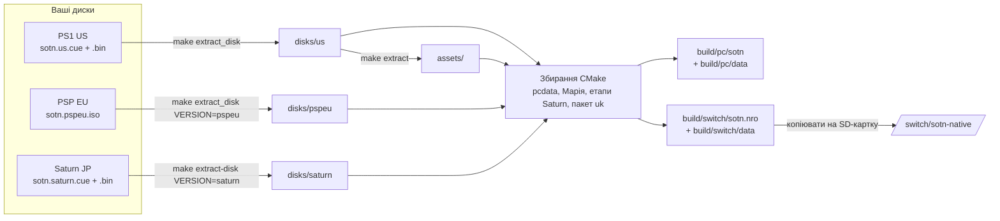

# sotn-native

Нативний порт Castlevania: Symphony of the Night для ПК (Linux) і Nintendo Switch.
Його зібрано з декомпіляції [sotn-decomp](https://github.com/Xeeynamo/sotn-decomp).
Він працює на [psyz](https://github.com/Xeeynamo/psyz) — PlayStation SDK для сучасних систем.
Порт додає вміст із версій для Sega Saturn і PSP та український переклад.

English: [README.md](README.md). README оригінального проєкту: [README.upstream.md](README.upstream.md).

**У цьому репозиторії немає даних гри.** Потрібні ваші власні, легально придбані диски.
Збирання читає їх із вашого диска і створює файли гри на вашому комп'ютері.

## Що працює

| Частина | Стан |
|---|---|
| Збірка для ПК (Linux, x86-64) з PS1 US | Працює. Основна платформа для перевірки коду. |
| NRO для Nintendo Switch (homebrew) | Працює. Перевірено на одній консолі. |
| Вигляд 16:9 з цілим масштабом, меню порту, значки кнопок, вібрація при ударі (Switch) | Працює. |
| Етапи Saturn: Підземний сад, Проклята в'язниця та їхні обернені версії; зшиті кімнати | Експериментально. Ворогів і босів перенесено вручну, вони можуть відрізнятися від гри на Saturn. |
| Екран вибору персонажа з Saturn | Працює. Для графіки потрібен диск Saturn. |
| Марія як гравець (з версії PSP) | Експериментально. |
| Імена фамільярів із PSP, дві японські картки фамільярів | Працює (картки — опція). |
| Набори голосів (японський і англійський PSP) | Працює, але див. «Набори голосів»: лише з цього репозиторію їх поки не зробити. |
| Українська мова | Працює в наших збірках, але див. «Українська мова»: лише з цього репозиторію пакет поки не зробити. |
| Чити, мапа телепорту, сторінка редактора тайлів (порт 8080, без пароля) | Інструменти для тестів. |

Усі перевірки ручні. Можливі помилки.

## Що потрібно

### Диски

Покладіть образи своїх дисків у `disks/` (див. нижче). sotn-decomp дає кожній версії назву.

| Диск | Назва в sotn-decomp | Обов'язковий | Що додає |
|---|---|---|---|
| PlayStation, США (SLUS-00067) | `us` | Так | Усю гру. |
| PSP, Castlevania: The Dracula X Chronicles, Європа (ULES-00841) | `pspeu` | Ні | Марію як гравця, її голос, імена фамільярів. |
| Sega Saturn, Японія (T-9527G) | `saturn` | Ні | Етапи Saturn, графіку екрана вибору персонажа. |

Збирання перевіряє лише те, що потрібні файли є. Інші видання дисків не перевірено.

### Інструменти (Debian або Ubuntu, також у WSL 2)

- Пакети оригінального проєкту: `sudo apt install $(cat tools/requirements-debian.txt)`.
- CMake 3.28 або новіший, Ninja, компілятор C і C++ (GCC або Clang).
- Rust (`rustup`, стабільний `cargo`). Потрібен для будь-якого збирання.
- Go 1.24 або новіший. Потрібен для етапів Saturn і Марії.
- `xxd` (голос Марії), `7z` (PSP), `bchunk` (Saturn), `ffmpeg` з декодером ATRAC3plus (набори голосів).
- Python 3 з Pillow (з FreeType і libraqm), PyYAML і numpy:
  `sudo apt install python3-pil python3-yaml python3-numpy libraqm0`.
  Перевірка: `python3 -c "from PIL import features; print(features.check('freetype2'), features.check('raqm'))"` виводить `True True`.
- Для збирання під Linux: пакети розробки X11 або Wayland, потрібні SDL3
  (див. документацію SDL3; SDL збирається з `tools/psyz/external/SDL`).

Для збирання під Switch також потрібно:

- [devkitPro](https://devkitpro.org/wiki/Getting_Started) з `switch-dev`, `switch-mesa` і `switch-libdrm_nouveau`
  (`sudo dkp-pacman -S switch-dev switch-mesa switch-libdrm_nouveau`).
- Форк SDL3 від devkitPro, гілка `switch-sdl-3.4`, з латкою з цього репозиторію:

  ```sh
  git clone -b switch-sdl-3.4 https://github.com/devkitPro/SDL.git ~/SDL-switch
  git -C ~/SDL-switch am "$PWD/tools/sdl-switch/0001-switch-SetWindowSize-uses-the-pending-size.patch"
  ```

  Другу команду запускайте з кореня цього репозиторію.

## Як усе поєднано



## Збирання, крок за кроком

### 1. Отримайте код

```sh
git clone --recurse-submodules -b switch https://github.com/rashevskyv/sotn-native.git
cd sotn-native
```

### 2. Покладіть диски в `disks/`

- PS1: файл `.cue` і його доріжки `.bin`. Перейменуйте cue-файл на `disks/sotn.us.cue`.
  Рядки `FILE` у cue мають вказувати на файли `.bin` (відносно `disks/`).
- PSP: `disks/sotn.pspeu.iso`.
- Saturn: `disks/sotn.saturn.bin` і `disks/sotn.saturn.cue`.

### 3. Розпакуйте диски

```sh
make extract_disk                       # PS1 -> disks/us
make extract_disk VERSION=pspeu         # PSP -> disks/pspeu (необов'язково)
make extract-disk VERSION=saturn        # Saturn -> disks/saturn (необов'язково)
make python-dependencies                # Python-інструменти sotn-decomp, у .venv
make extract                            # ресурси PS1 -> assets/
```

З образу PSP потрібні лише ці файли:
`PSP_GAME/USRDIR/res/ps/PSPBIN/dra.bin`, `maria.bin` і `res/ps/snd_e/SE/sd_mar2.spk`.

### 4. Збирання для ПК (Linux)

```sh
cmake -S . -B build/pc -G Ninja -DENABLE_ASAN=OFF -DPSYZ_RENDERER=sdl3_gl \
      -DENABLE_SATURN_STAGES=ON
cmake --build build/pc
```

- Приберіть `-DENABLE_SATURN_STAGES=ON`, якщо диска Saturn немає.
- Марія вмикається сама, коли є `disks/pspeu/.../maria.bin` (`-DUSE_PLAYER_MARIA=OFF` вимикає її).
- Необов'язково: `-DSOTN_CHARSEL_ART=<тека>` з вашими портретами для екрана вибору персонажа
  (`alucard.webp`, `richter.webp`, `maria_psp.png`, `maria_psx.png`). Замість відсутнього файлу буде портрет із Saturn.
- `make pc` — короткий спосіб зібрати з типовими опціями.

Запуск:

```sh
build/pc/sotn
```

Гра читає файли з `build/pc/data` (копія `disks/us` плюс етапи Saturn).
Налаштування: `build/pc/sotn --ini sotn.ini` читає і записує файл налаштувань (див. «Налаштування»).

### 5. Збирання для Nintendo Switch

```sh
export DEVKITPRO=/opt/devkitpro
cmake -S . -B build/switch -G Ninja \
      -DCMAKE_TOOLCHAIN_FILE=$DEVKITPRO/cmake/Switch.cmake -DCMAKE_BUILD_TYPE=Release \
      -DENABLE_ASAN=OFF -DPSYZ_RENDERER=sdl3_gl -DPSYZ_SDL_DIR=$HOME/SDL-switch \
      -DENABLE_SATURN_STAGES=ON
cmake --build build/switch
```

Результат — `build/switch/sotn.nro`. Ті самі необов'язкові опції, що й для ПК.

### 6. Встановлення на Switch

Порт має власну теку на SD-картці: `/switch/sotn-native/`.

| Шлях на SD-картці | Що це | Звідки |
|---|---|---|
| `/switch/sotn-native/sotn.nro` | Програма | `build/switch/sotn.nro` |
| `/switch/sotn-native/data/` | Файли гри | `build/switch/data/` (усе) |
| `/switch/sotn-native/data/ST/<STAGE>/F_<STAGE>.BIN` | Зшиті кімнати Saturn (лише з етапами Saturn) | `build/switch/saturn_stitches/disks/us/ST/` (скопіюйте поверх `data/ST/`) |
| `/switch/sotn-native/voice/jp/`, `voice/psp/` | Набори голосів (необов'язково) | див. «Набори голосів» |
| `/switch/sotn-native/sotn.ini` | Налаштування | гра пише його під час першого запуску |

Гра також пише туди: `sotn-xa.cue` (музика; вказує на `data/SD/XA_STR1`),
`sotn.log`, `sotn.prev.log`, `sotn.out.log` і картки пам'яті `bu00/` та `bu10/`.
Інших файлів не потрібно. Запускайте порт із меню homebrew.

## Налаштування (`sotn.ini`)

Якщо файлу немає, гра записує його з типовими значеннями.
Більшість значень змінює меню порту в грі. Відсутній ключ має типове значення.

| Ключ | Значення | Типово | Дія |
|---|---|---|---|
| `scale` | від 1 до 8 | 3 | Цілий масштаб пікселя для вигляду 16:9. |
| `voice` | `ps1`, `jp`, `psp` | `ps1` | Набір голосів. `jp` і `psp` потребують кліпів у `voice/`; замість відсутнього кліпу звучить голос PS1. |
| `language` | `en`, `uk` | `en` | Мова. Зміна потребує перезапуску. `uk` без пакета показує англійську. |
| `buttons` | `switch`, `xbox`, `psx` | `switch` на Switch, `xbox` на ПК | Значки кнопок у меню. |
| `jp_cards` | `extra`, `jp`, `off` | `extra` | Дві японські картки фамільярів: поруч із предметами США, на місцях JP/PSP або без них. Читається під час запуску. |
| `relic_toggle` | `modern`, `stock` | `modern` | Вигляд перемикача реліквій. |
| `spawn` | назва або порожньо | порожньо | Тестова точка старту: `np3-stage15-door`, `marble-soul`, `caverns-soul`, `reverse-trapdoor-underground`, `reverse-marble-soul`, `reverse-caverns-soul`. |
| `cheat_refill` | 0, 1 | 0 | HP, MP і серця завжди повні. |
| `cheat_invincible` | 0, 1 | 0 | Удари не шкодять. |
| `cheat_walls` | 0, 1 | 0 | Туман проходить крізь будь-яку стіну і не закінчується. |
| `cheat_items` | 0, 1 | 0 | Уся зброя, предмети і реліквії. |
| `cheat_map` | 0, 1 | 0 | Уся мапа обох замків. |
| `cheat_skip_prologue` | 0, 1 | 0 | Нова гра починається за Алукарда біля брами замку. |
| `cheat_character` | 0, 1, 2, 4 | 0 | Хто грає в завантаженому збереженні: 0 — правило гри, 1 — Алукард, 2 — Ріхтер, 4 — Марія. |
| `editor` | 0, 1 | 0 | Сторінка редактора тайлів на порту 8080. Без пароля: вмикайте лише в довіреній мережі. |
| `overlay` | 0, 1 | 0 | У куті видно етап, кімнату і чити. |
| `fps` | 0, 1 | 0 | У куті видно кадри за секунду. |

Ключ `aspect` зі старих файлів ігнорується: вигляд завжди 16:9.
Етапи Saturn і Марія — опції збирання, а не налаштування. Вібрація завжди ввімкнена (Switch).

## Набори голосів

`tools/voicepack/extract_voice.py` створює `voice/jp/` і `voice/psp/` з образу PSP.
Йому потрібні два файли-маніфести, що зіставляють кожен звук із кліпом в образі.
Маніфестів поки немає в цьому репозиторії, тож лише з нього набори голосів не зробити.
Без них гра використовує голоси PS1.

## Українська мова

Текст, шрифти і намальовані написи лежать у `tools/lang/` (див. `tools/lang/FORMAT.md`).
Пакет створюється під час збирання. Йому також потрібні три локальні джерела:
`SOTN_LANG_XBLA` (робоча тека перекладу), `SOTN_LANG_PICORIPI` (тека плагіна
`castlevania_sotn_xbla` з [Picoripi](https://github.com/rashevskyv/Picoripi))
і `SOTN_LANG_MEDIA` (файли українського мода для Xbox 360).
Робоча тека і файли мода поки не публічні. Без них збірка має лише англійську.

## Подяки

- [sotn-decomp](https://github.com/Xeeynamo/sotn-decomp): Luciano Ciccariello (Xeeynamo) і всі учасники. Інструменти, яким вони дякують, — у [README.upstream.md](README.upstream.md).
- [psyz](https://github.com/Xeeynamo/psyz) від Xeeynamo (MIT), з SDL (libsdl.org) і cimgui.
- sotn-vita від artesanalintelligence: шаблони даних для ПК (`tools/pcdata`), підключення босів і схема статичних модулів psyz.
- sotn-ultimate: етапи Saturn і екран вибору персонажа перенесено з його перекладу коду Saturn.
- devkitPro і його форк SDL для Switch.
- [Alegreya Sans](https://github.com/huertatipografica/Alegreya-Sans) від The Alegreya Sans Project Authors (SIL Open Font License 1.1, `tools/lang/fonts/OFL-AlegreyaSans.txt`).
- Picoripi: інструмент українського перекладу.

Castlevania і Symphony of the Night — торгові марки Konami. Проєкт не пов'язаний із Konami.

## Ліцензія

GNU Affero General Public License v3 (див. [LICENSE](LICENSE)), як і sotn-decomp.
Підмодулі та шрифти мають власні ліцензії.
