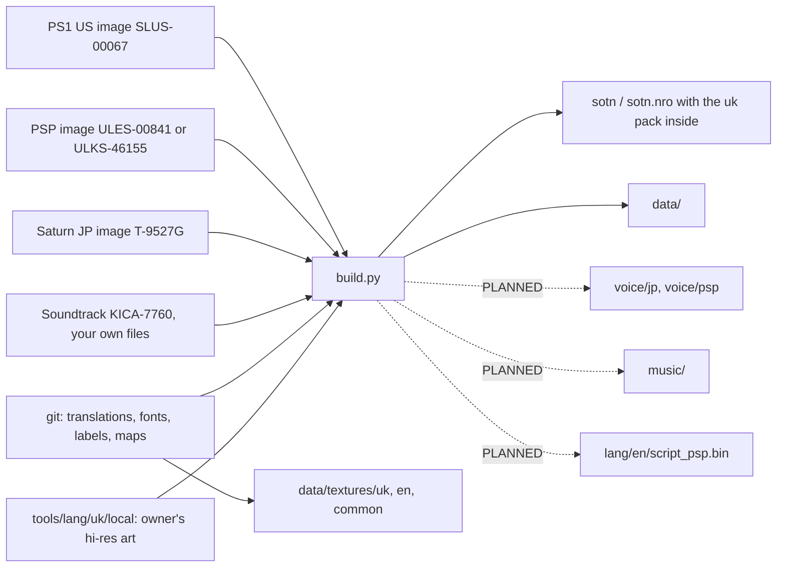

# Asset sources

This file says where each piece of game data comes from.
Rule: git holds only our own work. Nothing proprietary is in git.
Stock data is made on your machine from your own discs.
"Stock" means: from the original game discs, not our work.
"Local" means: made by the build, never committed, never in a release file.
"PLANNED" marks a part that is designed but not built yet.
"UNKNOWN" marks a fact that is not checked.
Tests and release checks: [TESTING.md](TESTING.md). Fonts: [FONTS.md](FONTS.md).

## Flow

Today `build.py` makes the program and `data/` only (Linux and Switch).
The Windows `sotn.exe` is a manual MinGW build (see `README.md`).
The dashed steps are PLANNED. Today you run their tools by hand:
`tools/voicepack/extract_voice.py`, `tools/music/ost_map.py`, `tools/lang/uk/hd_textures.py`.

## Inputs you supply

| Input | Id | Put it in | Required |
|---|---|---|---|
| PlayStation, USA | SLUS-00067 | `games/` | Yes |
| PSP, The Dracula X Chronicles | ULES-00841 (Maria); ULKS-46155 (voices, PSP text, Japanese text) | `games/` | No |
| Sega Saturn, Japan | T-9527G | `games/` | No |
| Official soundtrack, 34 MP3 files "NN Title.mp3" | KICA-7760 | `games/ost/` (PLANNED: also a zip) | No |
| `ps1vram_uk.bin` of the Ukrainian Xbox 360 mod | none | `games/` | No |
| Owner's hi-res pictures | none | `tools/lang/uk/local/` | No |

UNKNOWN: does the ULES-00841 image hold the same voice clips as ULKS-46155? Not checked.
Today `build.py` accepts only ULES-00841 (PLANNED: both ids).

## Text

| Item | Source | How it is made | Installed as | In git | Licence |
|---|---|---|---|---|---|
| Stock PS1 English text | PS1 US image | `make extract` to `assets/`; compiled into the game | inside the program | No | Stock, local |
| Ukrainian text, PS1 and JP voice | Our translation from Japanese | `tools/lang/uk/ua.json` -> `sotn_lang.py pack` -> `script.bin`, `text.bin` | inside the program (`lang_pack_uk.c`) | Yes | AGPL-3.0 (ours) |
| Ukrainian text, PSP voice | Our translation of the PSP boxes | `tools/lang/uk/ua_psp.json` -> `script_psp.bin` | inside the program | Yes | AGPL-3.0 (ours) |
| Ukrainian boxes that change after the audit against Japanese | Our translation | PLANNED: `tools/lang/uk/ua_jp.json` -> `script_jp.bin` | inside the program | Yes | AGPL-3.0 (ours) |
| English from Japanese (158 boxes) | Our translation | PLANNED: `tools/lang/en/en_jp.json` -> `script_jp_en.bin` | inside the program | Yes | AGPL-3.0 (ours) |
| PSP English text (164 boxes with text) | PSP image, `PSP_GAME/USRDIR/res/ps/PSPBIN/<zone>.bin` | PLANNED: `tools/lang/psp_text.py` (port of the owner's `psptext/extract.py`) -> `lang/en/script_psp.bin` | loose file next to the game | No | Stock, local |
| Japanese dialogue text | PSP image, `res/ps/hdbin/<zone>.bin` | PLANNED: `tools/lang/psp_text.py --jp` -> `build/auto/text/jp.jsonl` | not installed; translators and the audit read it | No | Stock, local |
| Menu, item, enemy and port words (uk) | Our translation | `ua.json`, `ua_menu.json`, `ua_port.json`, `ua_zones.json`, `ua_code.json` | inside the program | Yes | AGPL-3.0 (ours) |
| Prologue scroll text (uk) | Our translation | `tools/lang/uk/prologue.txt` -> `prologue_text.py` | inside the program | Yes | AGPL-3.0 (ours) |
| Places of each line in the US data | Hashes only, no text | `tools/lang/uk/places.json` | build input | Yes | AGPL-3.0 (ours) |

Facts: the Japanese PS1 text and the Japanese PSP text are equal in 157 of 158 boxes
(step 105). The PSP sound id plus 2 is the PS1 US sound id (PSP text report).
Five boxes have a different sound order in Japanese (step 105, plan item 4): open.
13 boss boxes (bo6, bo2) are still stock English: open.

## Which text shows with which voice

| language | voice | Script file | Text source | State |
|---|---|---|---|---|
| en | ps1 | none | stock PS1 text | Works |
| en | jp | `script_jp_en.bin` | `en_jp.json` | PLANNED (today: stock PS1 text) |
| en | psp | `lang/en/script_psp.bin` | PSP image | PLANNED (today: stock PS1 text) |
| uk | ps1 | `script.bin` | `ua.json` | Works |
| uk | jp | `script_jp.bin` | `ua.json` + `ua_jp.json` | PLANNED (today: `script.bin`) |
| uk | psp | `script_psp.bin` | `ua_psp.json` | Works |

Today a missing script file leaves the stock text (`LangSwap` in `src/pc/cutscene_pc.c`).
PLANNED: a missing script file falls back one step: en -> stock text, uk -> `script.bin`.
Today `Lang_File` (`src/pc/lang.c`) reads only the pack inside the program, not a loose `lang/` folder.
A loose `lang/en/script_psp.bin` needs that change first.

## Voices

| Item | Source | How it is made | Installed as | In git | Licence |
|---|---|---|---|---|---|
| PS1 English voice | PS1 US image, `SD/XA_STR1` | copied by the build | `data/SD/XA_STR1` | No | Stock, local |
| Japanese voice, 183 clips (160 bound to boxes) | PSP image ULKS-46155, `res/ps/sound/XA/*.at3` | `tools/voicepack/extract_voice.py` with the jp manifest; ffmpeg ATRAC3plus | `voice/jp/<ID>.pcm` (s16le, mono, 37800 Hz) | No | Stock, local |
| PSP English voice, 179 clips | PSP image, `res/ps/snd_e/XA/*.at3` | same tool, the pspen manifest | `voice/psp/<ID>.pcm` | No | Stock, local |
| Voice manifests (id, file name, size, SHA-256, length, gain) | Our mapping work | PLANNED: `tools/voicepack/manifest_jp.json`, `manifest_psp.json` | build input | PLANNED: yes | AGPL-3.0 (ours) |
| Maria's voice | PSP image, `res/ps/snd_e/SE/sd_mar2.spk` | CMake, needs `xxd` | inside the program | No | Stock, local |

`<ID>` is the PS1 US sound id, 3 upper hex digits, 0x358 to 0x534.
A missing clip plays the PS1 voice. About 326 PSP clips have no English script: not used.

## Music

| Item | Source | How it is made | Installed as | In git | Licence |
|---|---|---|---|---|---|
| Disc music (XA) | PS1 US image | copied by the build | `data/SD/XA_STR1` | No | Stock, local |
| Soundtrack files | Your own copy of KICA-7760 | `tools/music/ost_map.py copy <ost> <game>/music` | `music/<ID>.mp3` (or `.flac`) | No | Stock, local |
| Track map and loop points | Our measurements (`ost_map.py verify`) | table in `tools/music/ost_map.py` | `music/loops.txt` | Yes (the table) | AGPL-3.0 (ours) |

Without a file the disc music plays. `music_files = 0` always plays the disc music.

## Pictures in VRAM (1x)

| Item | Source | How it is made | Installed as | In git | Licence |
|---|---|---|---|---|---|
| Stock pictures | PS1 US image | copied by the build | `data/` | No | Stock, local |
| uk 8x8 letters, dialogue font, menu font, 12x16 letters | Our drawings | `font8.png`, `dfont.png`, `bios12.png`, `serif_latin.py` -> pack | inside the program | Yes | AGPL-3.0 (ours); see FONTS.md |
| uk stage banners and the ST0 card (15 labels) | Our render, Monotype Corsiva | Picoripi `ps1_vram.py` -> `tools/lang/uk/labels/zone_*.png`, `bloodlines.png` | `art.bin` inside the program | Yes | Our pictures; the font is not in git |
| uk gothic letters of the file select | Our drawing | `tools/lang/uk/labels/gothic.png` | `art.bin` | Yes | AGPL-3.0 (ours) |
| Ten uk labels that keep stock pixels (file select titles, name plate, HUD) | Ukrainian Xbox 360 mod | `ps1vram_uk.bin` in `games/` -> pack | `art.bin` | No | Stock-derived, local |
| Three file-select plates | PS1 US image, cleared by the pack | `tools/lang/uk/plates.py` (rules only) | `art.bin` | Rules: yes. Pixels: no | Stock-derived, local |
| "1792" card (uk) | Our render, Alegreya Sans Italic | `plates.py` `title_card` | `art.bin` | Yes (rule and font) | OFL-1.1 font |
| Status popup words (uk) | PS1 US image (Latin twin letters, stock rows cleared) and our hand-drawn Cyrillic 3x5 masks; the HD pictures (textures/uk/popup_*) are drawn from the same masks, no stock pixel | `tools/lang/uk/popup_words.py` | `art.bin` | Rules and masks: yes. Pixels: no | Stock-derived, local |
| uk title logo, PRESS START, loading text, title background, game-over picture | Owner's pictures made from stock art | `tools/lang/uk/local/art.bin` | `art.bin` | No | Stock-derived, local |
| Saturn stages and character select art | Saturn image | CMake, `-DENABLE_SATURN_STAGES=ON` | `data/ST/...` | No | Stock, local |

## HD pictures (loose PNG)

Loader name: `<free text>__<x>_<y>_<w>x<h>_<bpp>_<hash8>[_c<clut8>].png` (see `tools/lang/FORMAT.md`).
Search order: `data/textures/uk/` or `data/textures/en/` first, then `data/textures/common/`.
Rule: a picture with words goes to `uk/` and `en/`. A picture without words goes to `common/`.
The HD packs are in git: `tools/lang/textures/{uk,en,common}` (PNG and `.hdt`). The build copies them to `data/textures/<lang>/` (CMake, next to `sotn_runtime_data`). The owner decided that this art (including upscales of stock art) ships with the repository.
Other files in `data/textures/` (`dump/` from HD DUMP, `play/`, `_bak_*`) are local and never in git.
Packed form: `python3 tools/hdtex_pack.py <png folder> <out folder>` writes a `.hdt` next to each name.
A `.hdt` holds BC1 or BC3 blocks with mipmaps (LZ4). The GPU takes it as is: no decode, about 1/4 of the memory.
The loader takes the `.hdt` before the `.png` of the same name. The `.png` stays the source and the fallback (no S3TC).

| Pack | Files | Made by | Source run |
|---|---|---|---|
| common: character cards, frame, arrows (10), menu backdrop `menubg` (1) | 11 | redraws | step 98 |
| common: dialogue portraits (two slots each) | 16 | redraws | steps 96 and 97 |
| common: prologue pictures (bridge, cliff, moon, towers) | 4 | redraws | step 94 |
| common: menu plaque, save cell | 2 | redraws | step 102a |
| common: button marks (PS, Xbox, Switch), gothic ABC sheet | 7 | vector drawing; redraw | steps 102b, 103 |
| uk: title background, logo, PRESS START, loading, game over, prologue title | 9 | `tools/lang/uk/hd_textures.py` from `tools/lang/uk/local/` | steps before 98 |
| uk and en: stage banners (13 x 2 CLUT files) and the ST0 card | 27 each | Monotype Corsiva at 8x | step 103 |
| uk and en: file select windows (2), five labels, gothic sheet, 1792 card | 9 each | redraws | step 103 (en windows: step 109) |
| common: HUD digits (stock pixels at 8x, no smoothing; hearts flicker CLUT) | 2 | `tools/hud_digits.py <F_GAME.BIN> <game>/data/textures/common` | hud branch |

The hash in a uk name belongs to one `art.bin`. A changed label needs a new hash.
UNKNOWN: the portrait keys were confirmed on Linux only (step 98 report).
`python3 tools/test/run.py offline --textures <game>/data/textures` checks the names and the uk/en pairs.

## Code and tools

| Item | Source | Licence |
|---|---|---|
| Game code | sotn-decomp | AGPL-3.0 |
| psyz | Xeeynamo/psyz, our fork in `tools/psyz` | MIT |
| SDL3 (devkitPro fork for the Switch) | libsdl.org | zlib |
| dr_mp3, dr_flac | mackron/dr_libs | public domain or MIT-0 |
| Alegreya Sans Italic | `tools/lang/fonts/` | OFL-1.1 |
